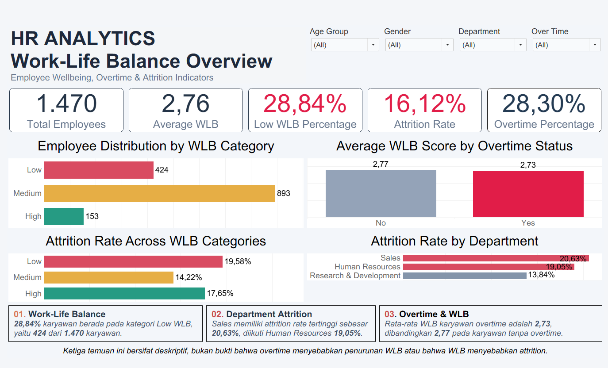

# Analisis Work-Life Balance Karyawan

### Overtime, kepuasan kerja, demografi, dan pola attrition

**Proyek HR Analytics untuk membantu HR membaca kelompok yang perlu ditinjau lebih lanjut.**

Work-Life Balance (WLB) sering diringkas menjadi satu skor. Namun, angka rata-rata saja belum menjawab pertanyaan yang lebih berguna bagi HR: bagaimana WLB tersebar di dalam organisasi, kelompok mana yang memiliki proporsi Low WLB lebih tinggi, dan bagaimana pola tersebut muncul bersama overtime, kepuasan, serta attrition?

Proyek ini mengolah dataset 1.470 karyawan menjadi analisis deskriptif dan dashboard interaktif. Hasilnya membantu HR dan manajemen memulai investigasi berbasis data, dengan tetap menghormati batas interpretasi dataset observasional.

> **Temuan bukan bukti sebab-akibat.** Analisis ini menunjukkan asosiasi, perbedaan, dan pola pada kelompok. Analisis tidak memprediksi karyawan individu yang akan resign.

## Jelajahi proyek

- **Dashboard Streamlit:** [hr-wlb-dashboard.streamlit.app](https://hr-wlb-dashboard.streamlit.app/)
- **Repositori GitHub:** [erielsdewantoro/hr-analytics-wlb](https://github.com/erielsdewantoro/hr-analytics-wlb)
- **Sumber file dataset:** [HR_Analytics_Encoded.csv](https://github.com/apoorva2796/DataSet/blob/master/HR_Analytics_Encoded.csv)

## Ringkasan eksekutif

| Indikator | Hasil |
|---|---:|
| Karyawan unik | 1.470 |
| Kolom pada data analisis | 41 |
| Nilai kosong setelah cleaning | 0 |
| Rata-rata Work-Life Balance | 2,76 dari 4 |
| Karyawan dalam kategori Low WLB | 424 (28,84%) |
| Attrition rate keseluruhan | 16,12% |
| Karyawan dengan overtime | 416 (28,30%) |
| Attrition rate overtime vs tanpa overtime | 30,53% vs 10,44% |

Angka tersebut memberikan beberapa arah tindak lanjut. Proporsi Low WLB tertinggi terlihat di Research & Development (30,70%) dan Job Level 4 (32,08%). Kelompok overtime juga memiliki attrition rate lebih tinggi pada data ini. Temuan tersebut layak ditinjau bersama konteks pekerjaan, ukuran sampel, dan faktor lain.

## Pertanyaan bisnis

1. Bagaimana distribusi WLB karyawan?
2. Departemen dan Job Level mana yang memiliki proporsi Low WLB lebih tinggi?
3. Bagaimana rata-rata WLB dan attrition berbeda menurut status overtime?
4. Bagaimana WLB dan kepuasan kerja muncul bersama pola attrition?
5. Kelompok mana yang layak menjadi prioritas investigasi HR?

## Temuan utama

- **Low WLB mencakup 28,84% karyawan.** Sebanyak 424 dari 1.470 karyawan masuk kategori Low.
- **Research & Development memiliki proporsi Low WLB tertinggi antar departemen:** 30,70% (295 dari 961 karyawan).
- **Job Level 4 memiliki proporsi Low WLB tertinggi antar level:** 32,08%, disusul Level 1 sebesar 31,31%.
- **Sales Job Level 4 menunjukkan proporsi Low WLB 41,18%, tetapi jumlah kelompok hanya 17 orang.** Angka kelompok kecil dapat berfluktuasi dan perlu dibaca dengan hati-hati.
- **Rata-rata WLB sedikit berbeda menurut status overtime:** 2,73 pada kelompok overtime dan 2,77 pada kelompok tanpa overtime.
- **Attrition rate kelompok overtime sebesar 30,53%, dibanding 10,44% pada kelompok tanpa overtime.** Ini adalah perbedaan deskriptif, bukan bukti overtime menyebabkan attrition.
- **Attrition rate menurut kategori WLB tidak meningkat secara berurutan:** Low 19,58%, Medium 14,22%, High 17,65%.
- **Kombinasi Job Satisfaction rendah dan Environment Satisfaction rendah memiliki attrition rate 27,10%,** tertinggi di antara sembilan kombinasi yang dianalisis.

## Dashboard dan dokumentasi

### Streamlit

Aplikasi menyediakan lima bagian analisis: Overview, WLB Analysis, Overtime & Satisfaction, Attrition Analysis, dan Data Explorer. Delapan filter global memperbarui KPI, chart, insight otomatis, tabel, dan unduhan berdasarkan segmen yang dipilih.

### Tableau

Screenshot dashboard Tableau disimpan di [docs/dashboard-screenshots](docs/dashboard-screenshots/). Dashboard mencakup Overview, WLB by Department & Job Level, serta Overtime, Satisfaction & Attrition.

### Presentasi dan carousel LinkedIn

Folder [docs/presentations](docs/presentations/) disiapkan untuk deck presentasi utama 15 slide dan ekspor PDF-nya. Folder [docs/linkedin-carousel](docs/linkedin-carousel/) disiapkan untuk versi ringkas 12 halaman yang dioptimalkan untuk LinkedIn. Letakkan hasil ekspor Canva di folder masing-masing setelah final.

## Metodologi

1. Membaca file HR Analytics encoded dari sumber yang dicantumkan di bagian Data & provenance.
2. Memprofilkan missing values, duplikasi, rentang nilai, dan kolom teknis/konstan.
3. Menghapus indeks ekspor dan duplikasi baris penuh, lalu menstandarkan label Attrition, Department, Gender, dan OverTime.
4. Menangani nilai tidak valid; nilai kosong diimputasi dengan median untuk numerik atau modus untuk kategorikal oleh pipeline.
5. Membentuk label skala WLB/kepuasan, kategori analitis, kelompok usia, kuartil pendapatan, dan masa kerja.
6. Menandai outlier dengan aturan IQR tanpa menghapusnya secara otomatis.
7. Menghitung ringkasan, agregasi kelompok, insight, serta uji asosiasi/perbedaan eksploratif.
8. Menampilkan hasil pada dashboard yang menggunakan satu DataFrame hasil filter agar angka antarkomponen tetap konsisten.

Pipeline analisis dapat dijalankan ulang melalui [scripts/analysis_pipeline.py](scripts/analysis_pipeline.py). File sumber encoded disertakan pada data/raw/ dan atribusinya dijelaskan di data/SOURCE.md. Dataset bersih ditulis ke data/clean_data.csv agar dapat digunakan aplikasi; tabel agregat, chart, dan ringkasan analisis disimpan pada output_hr_analytics/. Output tersebut mencakup high_risk_profile.csv yang berisi baris karyawan dari segmen analitis. File ini bukan prediksi dan bukan rekomendasi keputusan otomatis. Jangan membagikan atau mengunggah output baris karyawan; folder output diabaikan oleh Git.

### Definisi metrik

- **Low WLB:** WorkLifeBalance 1–2; Medium 3; High 4.
- **Rata-rata WLB / kepuasan:** rata-rata skor pada skala 1–4.
- **Attrition rate keseluruhan:** karyawan dengan Attrition = Yes dibagi seluruh karyawan unik.
- **Rate per kelompok:** jumlah karyawan dengan kondisi yang dihitung di dalam satu kelompok dibagi jumlah karyawan unik pada kelompok tersebut.
- **Ukuran sampel kecil:** kelompok dengan n < 30 perlu ditafsirkan lebih hati-hati.

## Menjalankan aplikasi

Gunakan Python 3.10 atau yang lebih baru.

    python -m venv .venv
    # Windows:
    .venv\Scripts\activate
    # macOS / Linux:
    source .venv/bin/activate
    pip install -r requirements.txt
    streamlit run app.py

Untuk membangun ulang data bersih dari file sumber:

    python scripts/analysis_pipeline.py

Skrip membaca data/raw/HR_Analytics_Encoded.csv. Output data bersih dipakai dashboard di data/clean_data.csv. Hasil analisis tambahan ditulis ke output_hr_analytics/, yang diabaikan oleh Git.

## Data & provenance

File encoded yang digunakan di proyek ini diperoleh dari repositori [apoorva2796/DataSet](https://github.com/apoorva2796/DataSet/blob/master/HR_Analytics_Encoded.csv), diakses pada 20 November 2026. Dataset upstream IBM mencatat lisensi ODbL 1.0 untuk database dan DbCL 1.0 untuk isi data. Rantai sumber dan tautan lisensi dicatat di [data/SOURCE.md](data/SOURCE.md).

Repository ini mengatribusikan IBM sebagai sumber upstream serta apoorva2796 sebagai lokasi salinan encoded. Data turunan yang dipublikasikan dan visualisasi publik mengikuti kewajiban pemberitahuan serta share-alike yang relevan.

Detail dan catatan penggunaan disimpan di [data/SOURCE.md](data/SOURCE.md).

## Batas interpretasi

- Dataset bersifat observasional. Temuan menunjukkan asosiasi, perbedaan, dan pola, bukan hubungan kausal.
- Overtime tidak dapat disebut menyebabkan attrition berdasarkan analisis ini.
- WLB rendah tidak dapat disebut menyebabkan karyawan resign.
- Hasil tidak memprediksi individu yang akan resign.
- “Attrition risk” hanya merujuk pada kelompok dengan attrition rate relatif tinggi.
- Dashboard menyajikan statistik deskriptif. Pipeline juga menyediakan uji chi-square dan Mann–Whitney eksploratif, tetapi belum mengontrol faktor perancu, mengoreksi pengujian berganda, atau menyertakan confidence interval.
- Data tidak memiliki tanggal snapshot/keluar, jam overtime aktual, alasan resign, maupun variabel workload; analisis tidak menunjukkan perubahan dari waktu ke waktu.

## Struktur repository

    .
    ├── app.py
    ├── functions.py
    ├── requirements.txt
    ├── scripts/
    │   └── analysis_pipeline.py
    ├── assets/
    │   └── custom.css
    ├── data/
    │   ├── clean_data.csv
    │   ├── SOURCE.md
    │   └── raw/
    │       ├── README.md
    │       └── HR_Analytics_Encoded.csv
    └── docs/
        ├── dashboard-screenshots/
        ├── presentations/
        └── linkedin-carousel/

Output sementara pipeline disimpan di output_hr_analytics/ dan tidak dimasukkan ke Git.

## Lisensi

Repository ini belum menetapkan lisensi open-source untuk kode. Dataset memiliki lisensi terpisah: ODbL 1.0 untuk database dan DbCL 1.0 untuk isi data. Lisensi dataset tidak otomatis mencakup kode, CSS, atau materi presentasi proyek. Rujuk [data/SOURCE.md](data/SOURCE.md) untuk atribusi serta tautan lisensi.

## Arah pengembangan

- Menguji perbedaan kelompok dan menambahkan confidence interval.
- Menggunakan analisis multivariat untuk mengendalikan faktor perancu.
- Mengumpulkan data lintas waktu agar perubahan WLB, overtime, dan attrition dapat dibandingkan.
- Menghubungkan setiap rekomendasi dengan indikator pemantauan dan evaluasi yang disepakati HR.

---

**Dibuat oleh Eriel Setiawan Dewantoro** · HR Analytics · Python, Pandas, Tableau, Streamlit
